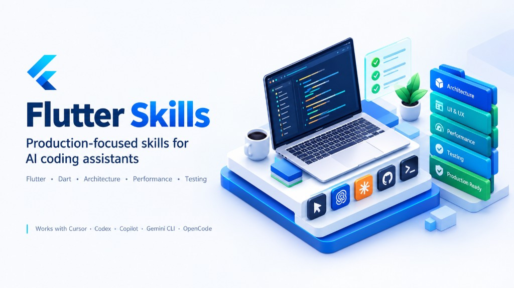

# Flutter Skills

A collection of production-focused skills for AI coding assistants working on Flutter and Dart. Each skill is a folder of guidance: when to apply it, which decisions matter, and which failure modes to avoid.

These folders are not Flutter packages. Nothing in this repository belongs in an application's `pubspec.yaml`. Installation for Cursor, Claude Code, Codex, GitHub Copilot, Gemini CLI, OpenCode, and other agents is in [INSTALL.md](INSTALL.md).



## Contents

- [How a skill works](#how-a-skill-works)
- [Requirements](#requirements)
- [Getting started](#getting-started)
- [Install a skill](#install-a-skill)
- [Installation guide](INSTALL.md)
- [Use a skill](#use-a-skill)
- [Related skills](#related-skills)
- [Skill catalog](#skill-catalog)
- [Repository layout](#repository-layout)
- [Landing page](#landing-page)
- [Validation](#validation)
- [Contributing](#contributing)
- [License](#license)

## How a skill works

The repository contains **70 skill folders** under [`skills/`](skills). Every folder has a `SKILL.md` manifest with YAML frontmatter. The `description` field is the trigger: a compatible assistant uses it to decide when the skill applies. The rest of the file is the operating guidance.

Supporting material stays inside that folder. Open it only when the manifest points to it.

| Path | Role |
| --- | --- |
| `SKILL.md` | Required. Scope, trigger, and operating guidance. |
| `references/` | Longer, version-sensitive, or platform-specific guidance. Present in most skills. |
| `examples/` | Worked examples. A few skills include them. |
| `evals/evals.json` | Sample prompts and expected behavior. Present in a few skills. |
| `agents/openai.yaml` | Optional display name, short description, and default prompt for tools that read it. |

Copy the whole folder. A skill that links to `references/` will not work if only `SKILL.md` is copied.

Some manifests also set `compatibility`. That field is a research baseline for that skill, not a Flutter version for this repository. Follow the skill's instruction to inspect the target project's SDK and package versions before using version-sensitive APIs.

## Requirements

Using a skill requires an agent that loads a directory containing `SKILL.md`. The commands in [INSTALL.md](INSTALL.md) target the directories those agents document. Reading this repository needs only a browser. Applying a skill needs the Flutter or Dart project you are changing.

The multi-agent installer `npx skills` needs Node.js 22.20 or later. `gh skill install` needs GitHub CLI. Manual copy needs `git` or `curl`. Individual skills name the packages and platforms they cover.

## Getting started

1. Pick a skill from the [catalog](#skill-catalog). The examples below use `flutter-go-router-engineering`.
2. Install that folder for your agent. From the Flutter app:

```sh
npx skills add ariaramin/flutter-skills --skill flutter-go-router-engineering
```

3. Start a new agent session and ask for the work in ordinary language. The skill's `description` decides when it applies.

For a personal install that follows you across projects, add `-g`. Paths, Windows commands, GitHub CLI, and copy-by-hand steps are in [INSTALL.md](INSTALL.md).

## Install a skill

| Need | Command |
| --- | --- |
| Choose agents interactively | `npx skills add ariaramin/flutter-skills --skill flutter-go-router-engineering` |
| Claude Code on this machine | `npx skills add ariaramin/flutter-skills --skill flutter-go-router-engineering -g -a claude-code -y --copy` |
| Cursor in this app, shared with Codex and Copilot | `gh skill install ariaramin/flutter-skills flutter-go-router-engineering --agent cursor --scope project` |
| A folder you place yourself | [Copy a skill yourself](INSTALL.md#copy-a-skill-yourself) |

Cursor, Codex, Copilot, Gemini CLI, and OpenCode can share `~/.agents/skills/<skill-name>/`. Claude Code uses `~/.claude/skills/<skill-name>/` instead. Project copies live under the app, for example `.agents/skills/` or `.claude/skills/`.

```sh
git clone https://github.com/ariaramin/flutter-skills.git
cd flutter-skills
mkdir -p ~/.agents/skills
cp -R skills/flutter-go-router-engineering ~/.agents/skills/
```

The landing page can download a folder with `curl`, `wget`, `npx degit`, or a sparse clone. Those commands do not choose an agent directory. [INSTALL.md](INSTALL.md) has the full placement table, the other agent flags, and what to check when a skill does not show up.

## Use a skill

Installed skills are instructions for the assistant, not libraries for the app. Do not add them as dependencies.

Example: with `skills/flutter-go-router-engineering` installed, ask:

> Add an auth redirect so signed-out users cannot open `/account`, and keep the existing shell routes.

The skill tells the assistant to inspect the current router, treat public URLs as a compatibility contract, and keep redirects deterministic. Its compatibility note targets a researched `go_router` baseline and still requires checking the versions in the app.

Two other shapes show up often:

- **Package choice.** "Should this app add a caching package, or is `dio` enough?" fits [Flutter package selection](skills/flutter-package-plugin-selection/SKILL.md).
- **Package authoring.** "Publish this plugin without breaking current users" fits [Flutter/Dart package engineering](skills/flutter-dart-package-engineering/SKILL.md).

## Related skills

Several skills sit next to each other. Use the narrower one when it matches.

| Task | Skill |
| --- | --- |
| Framework motion: springs, gesture velocity, interruption, reduced motion | [Flutter motion engineering](skills/flutter-motion-engineering/SKILL.md) |
| The Material `animations` package: `OpenContainer`, shared-axis, fade-through, and related transitions | [Flutter animations](skills/flutter-animations-production-engineering/SKILL.md) |
| Choosing, auditing, or rejecting a dependency | [Flutter package selection](skills/flutter-package-plugin-selection/SKILL.md) |
| Designing, testing, versioning, or publishing a package or plugin | [Flutter/Dart package engineering](skills/flutter-dart-package-engineering/SKILL.md) |
| General application changes across architecture, performance, and testing | [Flutter production engineering](skills/flutter-production-engineering/SKILL.md) |

[Flutter motion engineering](skills/flutter-motion-engineering/SKILL.md) records a local validation baseline of Flutter 3.47.0 stable, Dart 3.13.0, and DevTools 2.60.0. That baseline is not a claim about the newest SDK patch. The skill has three reference guides. `references/examples/` contains four Dart library files and six tests in `test/motion_test.dart`. Profile motion on the target device before treating it as fast.

Document capture is also split on purpose:

- [document_scan for Flutter](skills/document-scan-flutter/SKILL.md) covers headless detection, perspective correction, and live frames.
- [document_camera_frame](skills/document-camera-frame/SKILL.md) covers a custom framed camera, alignment, on-device OCR, and multi-page export.
- [flutter_doc_scanner](skills/flutter-doc-scanner/SKILL.md) covers ML Kit and VisionKit scanning plus PDF compilation.

## Skill catalog

Each link opens that skill's `SKILL.md`.

### Foundations and architecture

- [Dart args](skills/dart-args-production-cli/SKILL.md) — production command-line interfaces, subcommands, flags, and executable tooling.
- [Dart & Flutter Equatable](skills/dart-flutter-equatable-engineering/SKILL.md) — value equality, immutable state, and reliable rebuild behavior.
- [Freezed](skills/freezed-production-engineering/SKILL.md) — immutable models, sealed unions, JSON serialization, and code generation.
- [Dart & Flutter FFI](skills/dart-flutter-ffi-systems-engineering/SKILL.md) — native integration, memory ownership, ABI safety, and platform packaging.
- [Dart meta](skills/dart-meta/SKILL.md) — annotations, API contracts, immutability, and analyzer-guided modernization.
- [Senior Flutter architecture](skills/senior-flutter-architecture/SKILL.md) — production Flutter/Dart architecture with explicit trade-offs.
- [Design patterns](skills/shvets-design-patterns/SKILL.md) — 22 classic object-oriented patterns, with source-backed decisions, examples, and trade-offs.
- [Senior mobile architecture](skills/senior-mobile-architecture/SKILL.md) — architecture reviews and refactoring across iOS, Android, and cross-platform apps.
- [Flutter production engineering](skills/flutter-production-engineering/SKILL.md) — architecture, performance, scalability, cross-platform behavior, testing, profiling, and maintainability.
- [Flutter multi-environment](skills/flutter-multi-environment/SKILL.md) — development, staging, and production flavors, configuration, and delivery pipelines.
- [Flutter package selection](skills/flutter-package-plugin-selection/SKILL.md) — evidence-based dependency evaluation and migration decisions.
- [Flutter/Dart package engineering](skills/flutter-dart-package-engineering/SKILL.md) — design, test, version, and publish Dart packages, Flutter packages, plugins, FFI packages, and federated plugins.
- [Flutter lints & static analysis](skills/flutter-lints-static-analysis-engineering/SKILL.md) — analyzer configuration, lint governance, and CI quality gates.
- [Flutter production build & release](skills/flutter-production-build-release/SKILL.md) — production builds, signing, packaging, stores, and release recovery.
- [Flutter Firebase Core](skills/flutter-firebase-core-engineering/SKILL.md) — Firebase bootstrap, generated configuration, environments, and app-instance lifecycle.
- [Flutter mobile development](skills/flutter-mobile-development/SKILL.md) — practical Flutter delivery across app structure, UI, state, platform, testing, and release work.

### UI and user experience

- [Figma to Flutter](skills/figma-to-flutter-expert/SKILL.md) — Flutter implementation of Figma frames, Auto Layout, tokens, and responsive multi-platform UI.
- [HTML to Flutter](skills/html-to-flutter/SKILL.md) — production Flutter ports of HTML/CSS/JavaScript interfaces.
- [React to Flutter](skills/react-to-flutter/SKILL.md) — behavior-preserving React web migrations to Flutter.
- [Flutter animations](skills/flutter-animations-production-engineering/SKILL.md) — Material motion, transitions, accessibility, and animation performance.
- [Flutter motion engineering](skills/flutter-motion-engineering/SKILL.md) — interaction continuity, interruptible springs, platform transitions, rendering diagnostics, accessibility, and tested Dart examples.
- [Rive Flutter](skills/rive-flutter/SKILL.md) — C++ runtime integration, state machines, inputs, layout, lifecycle, and multi-platform rendering with `rive`.
- [Lottie for Flutter](skills/lottie-flutter/SKILL.md) — pure Dart vector animations, composition caching, frame-rate throttling, dynamic delegates, marker playback, and list performance with `lottie`.
- [Flutter Confetti](skills/flutter-confetti-engineering/SKILL.md) — lifecycle-safe, accessible celebration effects and particle performance.
- [Flutter native splash](skills/flutter-native-splash-engineering/SKILL.md) — Android, iOS, and web launch resources, transitions, flavors, and startup behavior.
- [Flutter image performance](skills/flutter-image-performance/SKILL.md) — image loading, decoding, caching, rendering, and memory use.
- [Flutter image_picker](skills/flutter-image-picker-production-engineering/SKILL.md) — photo and video acquisition, lost-data recovery, platform behavior, and media safety.
- [document_scan for Flutter](skills/document-scan-flutter/SKILL.md) — headless document detection, perspective correction, live camera frames, and scan testing on Android and iOS.
- [document_camera_frame](skills/document-camera-frame/SKILL.md) — framed camera, auto-capture alignment, on-device OCR, multi-page PDF or image export, and native document scanning.
- [flutter_doc_scanner](skills/flutter-doc-scanner/SKILL.md) — native ML Kit and VisionKit document scanning, multi-page image capture, and PDF compilation on Android and iOS.
- [Flutter pro_image_editor](skills/flutter-pro-image-editor-engineering/SKILL.md) — image editing, state persistence, export, privacy, and large-image performance.
- [Flutter video_player](skills/flutter-video-player-production-engineering/SKILL.md) — cross-platform playback, controller lifecycle, streaming, codecs, and decoder performance.
- [Flutter CamerAwesome](skills/camerawesome-flutter/SKILL.md) — camera preview, capture modes, ML Kit image analysis, orientation, and CameraX/AVFoundation performance.
- [Flutter Skeletonizer](skills/flutter-skeletonizer-engineering/SKILL.md) — accessible loading states.
- [Flutter SVG](skills/flutter-svg-engineering/SKILL.md) — rendering, theming, caching, performance, and SVG security.
- [Flutter Pinput](skills/flutter-pinput/SKILL.md) — PIN, OTP, and SMS verification fields with iOS and Android autofill, custom cursors, animations, and accessible theming.
- [Persian number utility](skills/persian-number-utility/SKILL.md) — Persian and Arabic digit normalization, number-to-words, Jalali dates, currency, and Iranian identifier validation.
- [Flutter design system from design.md](skills/flutter-design-system-from-design-md/SKILL.md) — turning a `design.md` spec into Flutter theme tokens, components, states, and validation checks.

### Performance and reliability

- [Flutter expert tips](skills/flutter-expert-tips/SKILL.md) — practical implementation, debugging, refactoring, and modernization.
- [Flutter concurrency, memory & performance](skills/flutter-concurrency-memory-performance/SKILL.md) — isolates, async workflows, lifecycle management, and resource efficiency.
- [Flutter caching](skills/flutter-caching-engineering/SKILL.md) — cache policy, invalidation, offline data, HTTP freshness, and resource bounds.
- [Mobile API caching](skills/mobile-api-caching/SKILL.md) — cache strategy, HTTP semantics, offline synchronization, and account isolation for iOS, Android, Flutter, React Native, and Kotlin Multiplatform.
- [Mobile app shrinking & release optimization](skills/mobile-app-shrinking-and-release-optimization/SKILL.md) — R8 keep rules, resource and dependency reduction, native symbols, app thinning, tree shaking, and release validation across Android, iOS, Flutter, React Native, and Kotlin Multiplatform.
- [Flutter jank optimization](skills/flutter-performance-jank-optimization/SKILL.md) — profiling and fixing dropped frames, slow scrolling, and latency.
- [Flutter UI performance](skills/flutter-ui-performance-engineering/SKILL.md) — frame-budget analysis, rebuild, layout, paint, and raster optimization, and production profiling.
- [Flutter memory leaks](skills/flutter-memory-leak-engineering/SKILL.md) — lifecycle defects, leak tracking, and regression prevention.
- [Flutter Squadron concurrency](skills/flutter-squadron-concurrency-engineering/SKILL.md) — workers, worker pools, cancellation, and web workers.

### Observability

- [Flutter Firebase Analytics](skills/flutter-firebase-analytics/SKILL.md) — product-event schemas, consent, identity, screen and ecommerce measurement, DebugView, and reporting quality.
- [Flutter Sentry](skills/flutter-sentry-engineering/SKILL.md) — crash reporting, tracing, symbolication, privacy, and production observability.
- [Flutter production logging](skills/flutter-production-logging/SKILL.md) — structured, privacy-conscious diagnostics and error reporting.

### Networking, navigation, and platform capabilities

- [Flutter Firebase Messaging](skills/flutter-firebase-messaging/SKILL.md) — FCM delivery across Android, iOS, macOS, and web.
- [Flutter Dio](skills/flutter-dio-engineering/SKILL.md) — production HTTP clients, auth, retries, transfers, and observability.
- [Flutter Dio cache interceptor](skills/flutter-dio-cache-interceptor-engineering/SKILL.md) — HTTP caching, revalidation, store selection, offline fallback, key isolation, and invalidation with `dio_cache_interceptor`.
- [Flutter go_router](skills/flutter-go-router-engineering/SKILL.md) — routing, deep links, redirects, nested navigation, and web URLs.
- [Flutter app links](skills/flutter-app-links-deep-link-engineering/SKILL.md) — Universal Links, Android App Links, and secure link delivery.
- [Flutter url_launcher](skills/flutter-url-launcher-engineering/SKILL.md) — external URI handling across platforms.
- [Flutter share_plus](skills/flutter-share-plus-engineering/SKILL.md) — cross-platform text, URI, file, and generated-content sharing.
- [Flutter WebView](skills/flutter-webview-production-engineering/SKILL.md) — embedded web content, navigation policy, security, and lifecycle.
- [Flutter local notifications](skills/flutter-local-notifications-production-engineering/SKILL.md) — permissions, scheduling, time zones, interactions, and recovery.
- [Flutter permission_handler](skills/flutter-permission-handler-engineering/SKILL.md) — runtime permissions, platform configuration, and privacy-aware flows.

### Storage and dependency injection

- [Flutter Supabase](skills/flutter-supabase-engineering/SKILL.md) — Auth, row-level security, database access, Realtime, Storage, Edge Functions, and production security.
- [Flutter Drift](skills/flutter-drift-persistence-engineering/SKILL.md) — relational persistence, reactive queries, migrations, concurrency, and cross-platform SQLite.
- [Flutter Hive](skills/flutter-hive-persistence-engineering/SKILL.md) — local persistence, schema changes, encryption, and recovery.
- [hydrated_bloc](skills/hydrated-bloc/SKILL.md) — Bloc and Cubit state persistence, keys, schema evolution, security, and testing.
- [Flutter path_provider](skills/flutter-path-provider-production-storage/SKILL.md) — durable filesystem storage and cleanup.
- [Flutter get_it & injectable](skills/flutter-get-it-injectable-dependency-injection/SKILL.md) — dependency lifetimes, scopes, startup, and testing.

### Security

- [Flutter secure storage](skills/flutter-secure-storage-security-engineering/SKILL.md) — protected credentials and platform key stores.
- [Flutter application security](skills/flutter-application-security-engineering/SKILL.md) — application security reviews and remediation.
- [Flutter app hardening](skills/flutter-app-hardening-reverse-engineering/SKILL.md) — reverse-engineering resistance, tamper protection, and secure releases.

### Testing and delivery

- [Test before deploy](skills/test-before-deploy/SKILL.md) — release-ready test selection using the "34 Test Before Deploy" taxonomy.

Build, signing, and store release live in [Flutter production build & release](skills/flutter-production-build-release/SKILL.md) under Foundations.

## Repository layout

```text
skills/<name>/SKILL.md           Skill manifest
skills/<name>/references/        Optional supporting guidance
index.html, styles.css, script.js
                                 Static landing page
.nojekyll                        GitHub Pages: serve files as-is
assets/social-preview.jpg        Social preview image
.github/workflows/validate.yml   Manifest check
.github/ISSUE_TEMPLATE/          Issue forms, including skill requests
INSTALL.md                       Agent installation guide
CONTRIBUTING.md                  Contribution rules
PUBLISHING.md                    GitHub publication and release checklist
```

There is no root `pubspec.yaml` and no GitHub Actions workflow other than skill validation.

## Landing page

[`index.html`](index.html), [`styles.css`](styles.css), and [`script.js`](script.js) are a dependency-free catalog page. It has no build step.

The cards and download paths come from `skills` and `categories` in `script.js`. That list matches the [skill catalog](#skill-catalog): every folder, grouped the same way. `slug` is the folder name under `skills/`. Hero and collection counts are filled from this list.

### Run locally

Open `index.html` directly, or serve the repository root:

```sh
python3 -m http.server 8000
```

Then open `http://localhost:8000`.

### Change the page

- Edit the visible copy in `index.html`. The page credits Aria Ramin and links to this GitHub repository.
- Edit `skills` and `categories` together when adding or renaming a card. `slug` must be the real folder name.
- Edit the custom properties at the top of `styles.css` to retheme the page.
- Change `repository` in `script.js` if the GitHub repository moves. The install commands use that value.

Selecting cards generates `curl`, `wget`, `npx degit`, and Git sparse-checkout commands. `npx degit` downloads the complete `skills/` folder. The other commands download the selected folders.

### GitHub Pages

The site is published from the `main` branch root at <https://ariaramin.github.io/flutter-skills/>. [`.nojekyll`](.nojekyll) keeps GitHub Pages from running Jekyll over the skill folders. A push to `main` updates the site.

## Validation

[`.github/workflows/validate.yml`](.github/workflows/validate.yml) runs on pull requests and on pushes to `main`. The job fails when:

- any `skills/*.skill` archive is present
- `skills/` contains no `SKILL.md` files
- any directory directly under `skills/` is missing `SKILL.md`

Run the same check locally:

```sh
bash -c '
shopt -s nullglob
archives=(skills/*.skill)
(( ${#archives[@]} == 0 )) || { echo "Skills are folders with SKILL.md. Remove .skill archives."; exit 1; }
manifests=(skills/*/SKILL.md)
(( ${#manifests[@]} )) || { echo "No SKILL.md manifests found."; exit 1; }
for dir in skills/*/; do
  [[ -f "${dir}SKILL.md" ]] || { echo "$dir is missing SKILL.md"; exit 1; }
done
echo "Validated ${#manifests[@]} skills."
'
```

A directory under `skills/` that has no `SKILL.md` fails this check. Keep research notes inside an existing skill folder, or give a new skill its own manifest.

## Contributing

Contributions are licensed under the MIT License, as stated in [CONTRIBUTING.md](CONTRIBUTING.md). Keep each change focused on one skill or one documentation concern. Do not include secrets, private URLs, customer data, or unpublished source material. Verify version-sensitive package and API guidance against current primary documentation.

Pull requests use the repository's pull request template. The **Validate skills** check must pass before merge. Release steps are in [PUBLISHING.md](PUBLISHING.md). New skill ideas can use the skill-request issue form.

## License

Distributed under the [MIT License](LICENSE). See [CODE_OF_CONDUCT.md](CODE_OF_CONDUCT.md) and [SECURITY.md](SECURITY.md) for participation and vulnerability reporting. Skills are instructional text; [SECURITY.md](SECURITY.md) also covers guidance that could expose credentials, weaken application security, or create unsafe release practices.

Flutter and the related logo are trademarks of Google LLC. This is an independent community project and is not endorsed by Google.
