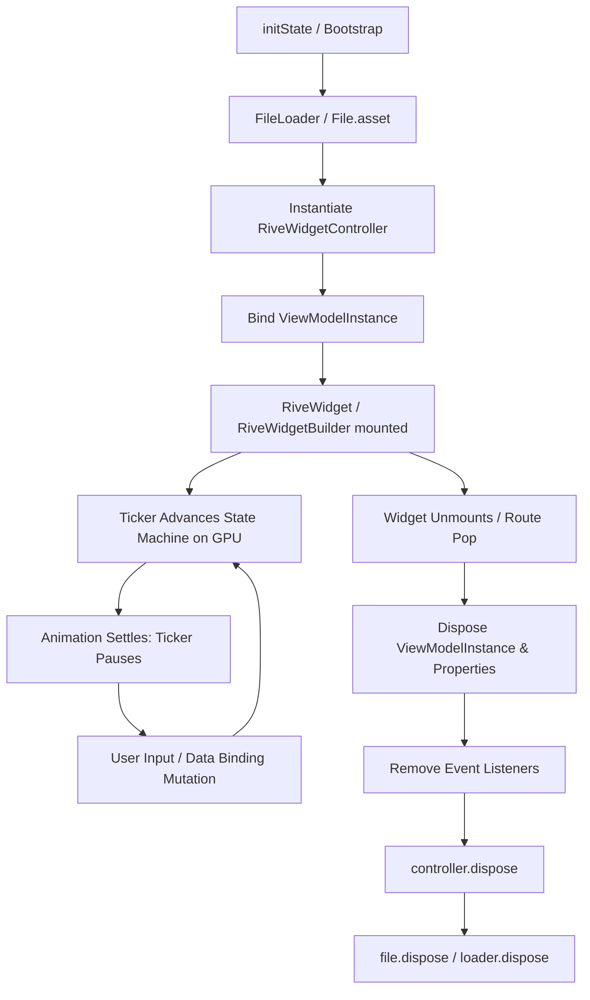

# Rive Flutter

## Purpose

This skill provides exhaustive, source-grounded operating instructions for an autonomous AI coding agent implementing, refactoring, optimizing, and reviewing Rive graphics within Flutter applications. It codifies the current official C++ runtime architecture (`rive: ^0.14.11` / `0.15.x-dev`), establishes strict resource ownership models, enforces multi-platform rendering safety, and prevents performance, memory, and lifecycle regressions.

---

## When to Use This Skill

Trigger this skill whenever a task involves:
- Integrating `.riv` vector animation assets into a Flutter codebase.
- Selecting between rendering pipelines (`Factory.rive` vs `Factory.flutter`).
- Interfacing with Rive State Machines, inputs (`TriggerInput`, `BooleanInput`, `NumberInput`), or transitions.
- Establishing modern Data Binding with Rive View Models (`ViewModelInstance`, lists, images, artboards).
- Managing Rive lifecycle, initialization (`RiveNative.init()`), and deterministic resource disposal.
- Optimizing Rive performance in lists, grids, carousels, navigation routes, or large-scale design systems.
- Mitigating platform-specific bottlenecks (e.g., WebGL context limits on Web, Impeller triage on iOS/Android, 16KB pages on Android).
- Auditing existing Flutter code for deprecated Rive APIs (`RiveAnimation.asset`, `StateMachineController`, `SMIBool`, `RiveEvent`, etc.).

---

## Core Principles

1. **Zero Work in `build()`:** NEVER load files, instantiate controllers, parse bytes, or allocate native render textures within Flutter `build()` methods.
2. **Deterministic Ownership:** Every native C++ handle allocated via FFI (`File`, `RiveWidgetController`, `SharedRenderTexture`, `ViewModelInstance`) MUST have a single, unambiguously defined owner responsible for invoking `.dispose()`.
3. **Texture Minimization:** NEVER allocate unbounded independent textures on screen. Multiple Rive widgets drawn concurrently MUST be batched onto a shared surface (`RivePanel` or `SharedRenderTexture`) or rendered via `Factory.flutter`.
4. **Data Binding Over Manual Inputs:** PREFER Rive Data Binding over direct mutation of state machine inputs or legacy text runs for all new development.
5. **Fail-Safe UI States:** Asynchronous Rive initialization MUST always provide explicit handling for loading, loaded, and error fallback states via sealed pattern matching (`RiveLoading`, `RiveLoaded`, `RiveFailed`).
6. **Graceful Settling:** State machines automatically pause frame advancing when animations settle. MUST NOT unsettle or invalidate state machines when graphics are offscreen or quiescent.

---

## Source of Truth

This skill is strictly grounded in official Rive documentation and current package metadata:
- **Official Runtime Docs:** https://rive.app/docs/runtimes/flutter/flutter
- **Package Specifications:** https://pub.dev/packages/rive (v0.14.11 / v0.15.0-dev)
- **Native Subsystem:** https://pub.dev/packages/rive_native (v0.1.11)
- **Migration & Architecture Guides:** https://rive.app/docs/runtimes/flutter/migration-guide
- **State Machines & Events:** https://rive.app/docs/runtimes/flutter/state-machines and `rive-events`
- **Data Binding Manual:** https://rive.app/docs/runtimes/flutter/data-binding
- **Caching & Layout Systems:** https://rive.app/docs/runtimes/flutter/caching-a-rive-file and `layouts`
- **Renderer Selection:** https://rive.app/docs/runtimes/choose-a-renderer/overview

---

## Version and API Awareness

### Runtime Generations
- **Legacy Dart Runtime (`rive` ≤ 0.13.20):** Pure Dart interpreter. Deprecated and moved to `github.com/rive-app/rive-flutter-legacy`.
- **Modern C++ Native Runtime (`rive` ≥ 0.14.0):** Powered by `rive_native` via Dart FFI. Replaces all legacy controllers, input primitives, and event systems with compiled native C++ bindings, hardware-accelerated Rive Renderer, Data Binding, Responsive Layouts, and Shared Render Textures.

### Version Constraints Baseline
```yaml
environment:
  sdk: ">=3.6.0 <4.0.0"
  flutter: ">=3.28.0"
```
*(Note: Flutter was raised to `>=3.28.0` in 0.14.2 due to Android `SurfaceProducer` cleanup callbacks).*

---

## Installation and Runtime Setup

### 1. Dependency Declaration
Add the verified modern package to `pubspec.yaml`:
```yaml
dependencies:
  flutter:
    sdk: flutter
  rive: ^0.14.11
```

### 2. Mandatory App Bootstrap Initialization
`RiveNative.init()` loads native dynamic libraries (`.dylib`, `.so`, `.dll`, WASM) and sets up factory dispatch tables. While called lazily on first load if omitted, failing to call it in `main()` causes frame drops and `LateInitializationError: Field 'makeFlutterFactory' has not been initialized`.

```dart
// lib/main.dart
import 'package:flutter/material.dart';
import 'package:rive/rive.dart';

Future<void> main() async {
  WidgetsFlutterBinding.ensureInitialized();
  // MUST initialize native runtime bindings before rendering any Rive graphics
  await RiveNative.init();
  runApp(const MainApp());
}
```

### 3. Native Binary Verification
Native binaries download automatically during `flutter run` / `flutter build`. If building in air-gapped CI or if native symbols fail to load, execute the setup tool:
```bash
dart run rive_native:setup --verbose --clean --platform macos # macos, ios, android, windows, linux
```

---

## Recommended Project Architecture

Separate Rive assets, state controllers, and presentations into structured architectural layers:

```text
lib/
├── core/
│   └── animation/
│       ├── rive_asset_registry.dart      # Strongly typed asset path constants
│       └── rive_file_cache.dart          # Preloaded File singleton / cache service
├── features/
│   └── feature_name/
│       ├── presentation/
│       │   ├── widgets/
│       │   │   └── interactive_card_art.dart  # Reusable UI component wrapping RiveWidget
│       │   └── controllers/
│       │       └── card_animation_coordinator.dart # Animation logic decoupled from UI
└── assets/
    └── rive/
        ├── navigation_icons.riv
        └── checkout_flow.riv
```

---

## Asset Organization

1. Store `.riv` files in a dedicated asset folder (e.g., `assets/rive/`).
2. Declare explicit asset targets in `pubspec.yaml` (avoid unbounded directory declarations in large projects to reduce asset manifest overhead):
```yaml
flutter:
  assets:
    - assets/rive/dashboard_metrics.riv
    - assets/rive/character_avatar.riv
```
3. Use typed string identifiers to avoid fragile typos:
```dart
abstract final class RiveAssets {
  static const String dashboardMetrics = 'assets/rive/dashboard_metrics.riv';
  static const String characterAvatar = 'assets/rive/character_avatar.riv';
}
```

---

## Loading Rive Files

Loading parses binary `.riv` data into native C++ artboards. MUST select a `riveFactory` (`Factory.rive` or `Factory.flutter`).

### Loading APIs Overview

| Method | Source | Lifecycle Strategy |
|---|---|---|
| `File.asset(path, riveFactory: ...)` | Flutter AssetBundle | Preloading, singleton caches, long-lived pages |
| `File.url(url, riveFactory: ...)` | Remote HTTP/HTTPS | Dynamic CMS assets; MUST cache in memory or disk |
| `File.path(path, riveFactory: ...)` | Local filesystem | Downloads, offline cache directories |
| `File.decode(bytes, riveFactory: ...)` | In-memory `Uint8List` | Decrypted buffers, isolate-fetched data |
| `FileLoader.fromAsset(path, ...)` | Reactive loader | Paired with `RiveWidgetBuilder` |
| `FileLoader.fromUrl(url, ...)` | Reactive loader | Paired with `RiveWidgetBuilder` |
| `FileLoader.fromFile(file, ...)` | Wraps loaded `File` | Shares existing cached `File` with `RiveWidgetBuilder` |

---

## Rive File and Runtime Object Ownership

Native C++ handles do not rely solely on Dart garbage collection; uncollected handles cause native GPU/RAM leaks.

### Ownership & Disposal Rules

| Object | Creator / Owner | Responsibility |
|---|---|---|
| `File` | Service / Repository / State | MUST call `.dispose()` when feature or application terminates. |
| `FileLoader` | `StatefulWidget` or Cache | MUST call `.dispose()` in `State.dispose()`. Disposes underlying file. |
| `RiveWidgetController` | `State` or `RiveWidgetBuilder` | `RiveWidgetBuilder` disposes automatically. If created manually, MUST dispose in `State.dispose()`. |
| `SharedRenderTexture` | Parent Component / Screen | MUST call `.dispose()` when surface unmounts. |
| `ViewModelInstance` | `RiveWidgetController` / State | MUST call `.dispose()` when no longer updated or before controller disposal. |
| `CustomProperty` / Inputs | Parent State Machine | Automatically cleared on `stateMachine.dispose()`, but inputs SHOULD be disposed when detached. |

**Disposal Order Rule:** When managing resources manually, dispose in **strict reverse order of creation**:
1. `ViewModelInstance.dispose()`
2. Event listeners / Input subscriptions
3. `RiveWidgetController.dispose()`
4. `File.dispose()`
5. `SharedRenderTexture.dispose()`

---

## Artboards

- A `.riv` file contains one or more artboards.
- The primary artboard is accessed via `file.defaultArtboard()`.
- Named artboards are retrieved via `file.artboard('ArtboardName')`.
- In declarative builders, select artboards using `ArtboardSelector`:
  - `ArtboardDefault()`
  - `ArtboardSelector.byName('Character')`
  - `ArtboardSelector.byIndex(1)`

---

## Animations

- Direct timeline animation playback (`OneShotAnimation`, `SimpleAnimation`, `animations: ['idle']`) is **legacy and discouraged**.
- Modern architecture mandates that all animations, layering, and blending be governed by a **State Machine**.
- For standalone single-animation playback without state machines, use `SingleAnimationPainter` and `RiveArtboardWidget`:
```dart
final painter = SingleAnimationPainter('walk_cycle');
// When unmounting:
painter.dispose();
```

---

## State Machines

State machines are the central execution engine of modern Rive files.

### 1. Playback Semantics
- **Advancing:** Evaluated frame-by-frame based on elapsed Delta Time.
- **Settling:** When transitions finish and no animated parameters are changing, the state machine enters a settled state, suspending the native frame ticker to conserve battery and CPU/GPU cycles.
- **Active Toggle:** Play/pause advancing via `controller.active = false` (pause) or `true` (resume).

### 2. Input Retrieval and Mutation
Access inputs through `controller.stateMachine`:

```dart
final stateMachine = controller.stateMachine;

// Modern Typed Inputs
final TriggerInput? jumpTrigger = stateMachine.trigger('jump');
final BooleanInput? isWalking = stateMachine.boolean('isWalking');
final NumberInput? speedLevel = stateMachine.number('speedLevel');

// Fire triggers
jumpTrigger?.fire();

// Mutate booleans & numbers
isWalking?.value = true;
speedLevel?.value = 2.5;

// Nested Artboard Inputs (Path Syntax)
final BooleanInput? nestedFlag = stateMachine.boolean('active', path: 'gear/helmet');
```

---

## Data Binding

Data Binding is the **preferred, modern standard** for Rive runtime communication (v0.14.0+), replacing fragile string-based inputs and direct text run manipulation.

### 1. Establishing Bindings
```dart
final controller = RiveWidgetController(file);

// 1. Auto-bind: Binds default ViewModel instance to State Machine & Artboard
final ViewModelInstance vmi = controller.dataBind(DataBind.auto());

// 2. Bind by explicit Editor name
final ViewModelInstance vmi = controller.dataBind(DataBind.byName('UserProfileVM'));

// 3. Bind to an externally managed instance
final ViewModelInstance vmi = controller.dataBind(DataBind.byInstance(sharedInstance));
```

### 2. Manipulating Properties
```dart
// Numeric properties
final scoreProp = vmi.number('score')!;
scoreProp.value = 1500.0;

// Text properties
final labelProp = vmi.string('username')!;
labelProp.value = 'Alex';

// Boolean properties
final verifiedProp = vmi.boolean('isVerified')!;
verifiedProp.value = true;

// Triggers
final submitProp = vmi.trigger('submit')!;
submitProp.fire();

// Property Observability
void onScoreChanged(double val) => print('New score: $val');
scoreProp.addListener(onScoreChanged);
// MUST remove or clear
scoreProp.removeListener(onScoreChanged);
scoreProp.dispose(); // Internally invokes clearListeners()
```

### 3. Dynamic Lists and Collections
```dart
final listProp = vmi.list('inventory')!;

// Create item instance from file's View Model blueprint
final itemVM = file.viewModelByName('InventoryItem')!;
final newItemInstance = itemVM.createInstance()!;
newItemInstance.string('name')!.value = 'Shield';

// List operations
listProp.add(newItemInstance);
listProp.removeAt(0);
listProp.swap(0, 1);
print('Items count: ${listProp.length}');
```

### 4. Dynamic Runtime Images and Artboards
```dart
// Swapping Images dynamically
final imageProp = vmi.image('avatarTexture')!;
final RenderImage? renderImage = await Factory.rive.decodeImage(rawPngBytes);
if (renderImage != null) {
  imageProp.value = renderImage;
}

// Swapping Nested Artboards (Skinning / Modularity)
final artboardProp = vmi.artboard('weaponSlot')!;
final BindableArtboard? swordArtboard = file.artboardToBind('Sword');
artboardProp.value = swordArtboard;
```

---

## Events and Listeners

> [!WARNING]
> Rive Events are **formally deprecated** in favor of Data Binding. Only use this section for legacy maintenance or specific signals like `OpenUrlEvent` and `AudioRuntimeEvent`.

Events are emitted by state machines as instances of the sealed class `Event`:

```dart
controller.stateMachine.addEventListener(_handleRiveEvent);

void _handleRiveEvent(Event event) {
  switch (event) {
    case GeneralEvent():
      final category = event.name;
      final CustomProperty? customProp = event.property('scoreDelta');
      final num? delta = event.numberProperty('scoreDelta')?.value;
      break;

    case OpenUrlEvent():
      final url = event.url;
      final target = event.target; // _blank, _self, etc.
      break;

    case AudioRuntimeEvent():
      // Triggered by audio timeline keys
      break;
  }
}

// MUST unsubscribe when unmounting
@override
void dispose() {
  controller.stateMachine.removeEventListener(_handleRiveEvent);
  controller.dispose();
  super.dispose();
}
```

---

## Layout, Fit, and Alignment

Rive graphics authoring dimensions rarely match target Flutter widget constraints.

### Fit Modes (`rive.Fit`)
NEVER use Flutter’s `BoxFit`. MUST use Rive’s `Fit` enum:

| Fit Enum | Scaling Behavior | Clipping / Padding |
|---|---|---|
| `Fit.contain` | **Default.** Scales preserving aspect ratio until bounds met. | Letterboxed if aspect ratios differ |
| `Fit.cover` | Scales preserving aspect ratio to fill container completely. | Clips overflowing dimensions |
| `Fit.layout` | **Rive Responsive Layout.** Executes Rive layout engine constraints. | Resizes artboard dynamically; no clipping |
| `Fit.fill` | Non-uniform stretch to exact widget width/height. | Distorts vector aspect ratio |
| `Fit.fitWidth` | Scales width to match container width. | Vertical clipping or empty padding |
| `Fit.fitHeight` | Scales height to match container height. | Horizontal clipping or empty padding |
| `Fit.scaleDown` | Behaves like `contain` if graphic is larger than container; otherwise 1:1. | No upscaling |
| `Fit.none` | Original authored pixel dimensions. | Clips if larger than container |

### Responsive Layout Configuration
When an artboard is designed using Rive Layouts (flexbox-like constraints):
```dart
RiveWidget(
  controller: controller,
  fit: Fit.layout,
  layoutScaleFactor: 1.0, // Scale multiplier (e.g. 2.0 for 2x crisp layout)
  alignment: Alignment.center,
)
```

---

## Flutter Widget Lifecycle

Correctly anchoring Rive within Flutter's widget tree lifecycle guarantees predictable frame pacing and zero memory leaks.



### Lifecycle Checklist
- **`initState()`:** Initialize async loading operations or configure cached controllers. NEVER invoke `setState()` until file loading succeeds.
- **`didUpdateWidget()`:** If `.riv` asset path changes, dispose existing controllers and reload. If only data-bound values change, write directly to properties; do NOT rebuild or reload the controller.
- **`dispose()`:** Release controllers, file loaders, textures, and custom listeners in reverse creation order.

---

## Resource Disposal

### 1. The Declarative Rule (`RiveWidgetBuilder`)
When using `RiveWidgetBuilder`, the widget **owns and disposes** the `RiveWidgetController` and its underlying `StateMachine` when unmounted.
- The host `StatefulWidget` MUST ONLY dispose the `FileLoader`.
- NEVER retain a reference to `state.controller` outside the builder scope.

```dart
class DeclarativeRiveView extends StatefulWidget {
  const DeclarativeRiveView({super.key});
  @override
  State<DeclarativeRiveView> createState() => _DeclarativeRiveViewState();
}

class _DeclarativeRiveViewState extends State<DeclarativeRiveView> {
  late final FileLoader _fileLoader = FileLoader.fromAsset(
    'assets/rive/hero.riv',
    riveFactory: Factory.rive,
  );

  @override
  void dispose() {
    _fileLoader.dispose(); // Disposes the cached file automatically
    super.dispose();
  }

  @override
  Widget build(BuildContext context) {
    return RiveWidgetBuilder(
      fileLoader: _fileLoader,
      builder: (context, state) => switch (state) {
        RiveLoading() => const SizedBox.shrink(),
        RiveFailed(:final error) => Center(child: Text('Error: $error')),
        RiveLoaded(:final controller) => RiveWidget(
            controller: controller,
            fit: Fit.contain,
          ),
      },
    );
  }
}
```

### 2. The Imperative Rule (`RiveWidget` Direct)
When constructing `File` and `RiveWidgetController` directly, you hold absolute ownership and MUST dispose everything:

```dart
@override
void dispose() {
  _vmi?.dispose();
  _controller.dispose();
  _file.dispose();
  super.dispose();
}
```

---

## State Management Integration

Decouple business logic and UI state machines cleanly across common state management libraries.

### Core Architectural Principle
Never pass `RiveWidgetController` or `StateMachine` through state management layers. The state management store (Bloc, Riverpod, Cubit, ChangeNotifier) MUST only emit plain Dart data primitives (integers, strings, booleans, enums). The Flutter UI layer consumes the state and updates the Rive Data Binding properties or inputs.

### 1. ValueNotifier / ChangeNotifier
```dart
class AnimatedCounter extends StatefulWidget {
  final ValueNotifier<int> countNotifier;
  const AnimatedCounter({super.key, required this.countNotifier});

  @override
  State<AnimatedCounter> createState() => _AnimatedCounterState();
}

class _AnimatedCounterState extends State<AnimatedCounter> {
  late final FileLoader _loader = FileLoader.fromAsset('assets/counter.riv', riveFactory: Factory.rive);
  ViewModelInstance? _vmi;

  @override
  void initState() {
    super.initState();
    widget.countNotifier.addListener(_syncCount);
  }

  void _syncCount() {
    _vmi?.number('counterValue')?.value = widget.countNotifier.value.toDouble();
  }

  @override
  void dispose() {
    widget.countNotifier.removeListener(_syncCount);
    _vmi?.dispose();
    _loader.dispose();
    super.dispose();
  }

  @override
  Widget build(BuildContext context) {
    return RiveWidgetBuilder(
      fileLoader: _loader,
      onLoaded: (state) {
        _vmi = state.controller.dataBind(DataBind.auto());
        _syncCount();
      },
      builder: (context, state) => switch (state) {
        RiveLoaded(:final controller) => RiveWidget(controller: controller),
        _ => const SizedBox.shrink(),
      },
    );
  }
}
```

### 2. BLoC / Riverpod Pattern
```dart
// Inside Widget build() or listener:
ref.listen<AsyncValue<int>>(cartCountProvider, (_, next) {
  next.whenData((count) {
    _cartViewModel?.number('itemCount')?.value = count.toDouble();
    _cartViewModel?.trigger('bump')?.fire();
  });
});
```

---

## Reusable Component Patterns

Build self-contained, theme-aware, resilient Rive components.

### Blueprint: Production Interactive Button
```dart
class RiveIconButton extends StatefulWidget {
  final String assetPath;
  final String stateMachineName;
  final VoidCallback onTap;
  final double size;

  const RiveIconButton({
    super.key,
    required this.assetPath,
    this.stateMachineName = 'State Machine 1',
    required this.onTap,
    this.size = 48.0,
  });

  @override
  State<RiveIconButton> createState() => _RiveIconButtonState();
}

class _RiveIconButtonState extends State<RiveIconButton> {
  late final FileLoader _loader = FileLoader.fromAsset(
    widget.assetPath,
    riveFactory: Factory.rive,
  );
  TriggerInput? _pressTrigger;
  BooleanInput? _hoverBool;

  @override
  void dispose() {
    _pressTrigger?.dispose();
    _hoverBool?.dispose();
    _loader.dispose();
    super.dispose();
  }

  @override
  Widget build(BuildContext context) {
    return SizedBox(
      width: widget.size,
      height: widget.size,
      child: MouseRegion(
        onEnter: (_) => _hoverBool?.value = true,
        onExit: (_) => _hoverBool?.value = false,
        child: GestureDetector(
          onTap: () {
            _pressTrigger?.fire();
            widget.onTap();
          },
          child: RiveWidgetBuilder(
            fileLoader: _loader,
            stateMachineSelector: StateMachineSelector.byName(widget.stateMachineName),
            onLoaded: (state) {
              _pressTrigger = state.controller.stateMachine.trigger('Pressed');
              _hoverBool = state.controller.stateMachine.boolean('Hovered');
            },
            builder: (context, state) => switch (state) {
              RiveLoaded(:final controller) => RiveWidget(controller: controller),
              _ => const SizedBox.shrink(),
            },
          ),
        ),
      ),
    );
  }
}
```

---

## Performance Engineering

### High Impact Optimizations
1. **Never Parse in `build()`:** File decoding takes 2–30ms of CPU time depending on asset size and complexity. Always retain `FileLoader` or `File` across widget builds.
2. **Batch Multiple Widgets with `RivePanel`:** On `Factory.rive`, every independent `RiveWidget` creates its own native GPU render target. Rendering 10 distinct widgets without a shared panel consumes 10x native texture allocations and GPU state context switches.
3. **Respect Animation Settling:** Ensure designer state machines have exit conditions that settle into static keyframes. Never loop idle animations invisibly off-screen.

### Medium Impact Optimizations
1. **Tune `RenderResolution`:**
   - `RenderResolution.display()`: Layout × DPR × ancestor paint scale. Reallocates backing store when animated by scaling transforms.
   - `RenderResolution.layout(scale: 1.0)`: Renders at base layout size and relies on composite upscaling via `FittedBox` / GPU texture sampling. Ideal for zoom/pan interfaces.
   - `RenderResolution.fixed(w, h)`: Fixed physical pixels (e.g. 512×512). Texture is NEVER resized or reallocated regardless of Flutter layout mutations.
2. **Cap Texture Dimensions:** Textures allocated under `Factory.rive` are automatically capped at 4096 logical pixels per axis. Sizing beyond this wastes GPU VRAM.

### Situational Optimizations
1. **Release Render Resources on Memory Pressure:**
   On Flutter Web or low-memory Android/iOS environments:
   ```dart
   RiveNative.instance.releaseRenderResources();
   ```
   Frees pooled native textures and probe contexts immediately; handles re-instantiate seamlessly on next draw.

---

## Platform Guidance

### Android
- **16KB Page Size:** Rive Flutter v0.14.x natively complies with Android 15 16KB memory page alignment out of the box. If compiling custom binaries on older NDKs, enforce NDK `28.1.13356709`.
- **SDK Constraint:** Requires Flutter `>=3.28.0` due to `TextureRegistry.SurfaceProducer` lifecycle cleanups (`onSurfaceCleanup`, `onSurfaceAvailable`).

### iOS
- **Impeller Compatibility:** Flutter iOS defaults to the Impeller graphics engine. If minor rendering anomalies appear under `Factory.flutter`, test with `flutter run --no-enable-impeller`. Alternatively, switch the Rive file to `Factory.rive` to completely bypass Impeller and render via Rive's native Metal C++ pipeline.
- **Swift Package Manager (SPM):** Supported in v0.14.4+. If symbol lookup failures (`Failed to lookup symbol`) occur on release builds, navigate in Xcode to **Runner Target > Build Settings > Strip Style** and switch from **All Symbols** to **Non-Global Symbols**.

### Web
- **WebGL Context Limits (CRITICAL):** Browsers enforce a hard cap of ~16 concurrent WebGL contexts across the entire tab (shared between Rive and Flutter CanvasKit).
- **Mandatory Web Strategy:**
  - MUST wrap multiple concurrent Rive animations in a single `RivePanel` or use `SharedRenderTexture`.
  - Disposing a Rive widget releases its WebGL context to a bounded recycling pool.
  - Enable debugging to inspect live context counts:
    ```dart
    RiveNative.debugRenderTextureLogging = true;
    ```

### macOS & Windows
- **macOS:** Fully compiled with Xcode 16.1+ Metal backend.
- **Windows:** Uses Direct3D 11 native textures. Version 0.14.11 resolves fence-wait thread deadlocks during fast window teardown or modal dismissals.

### Linux
- Full hardware-accelerated Rive Renderer support added in v0.14.4+ (X11 / Wayland). Requires prebuilt libraries or manual build for ARM64 architectures.

---

## Error Handling

The runtime throws typed, domain-specific exceptions. ALWAYS catch or pattern-match:

| Exception Class | Trigger Condition | Recommended Recovery |
|---|---|---|
| `RiveFileLoaderException` | Corrupt `.riv` header, invalid asset path, or network 404/timeout. | Display fallback static vector or retry network load. |
| `RiveArtboardException` | Artboard identifier not found in file. | Fallback to `file.defaultArtboard()`. |
| `RiveStateMachineException` | Requested state machine name or index missing. | Verify naming against editor; fallback to default. |
| `RiveDataBindException` | View model or bound property identifier mismatch. | Log contract mismatch in debug builds. |

### Robust Pattern Matching
```dart
RiveWidgetBuilder(
  fileLoader: fileLoader,
  builder: (context, state) => switch (state) {
    RiveLoading() => const AppLoadingIndicator(),
    RiveFailed(:final error, :final stackTrace) => ErrorBoundary(
        error: error,
        fallbackWidget: const Icon(Icons.broken_image),
      ),
    RiveLoaded(:final controller) => RiveWidget(controller: controller),
  },
)
```

---

## Debugging Guide

| Symptom | Root Cause | Solution |
|---|---|---|
| Graphic completely blank / invisible | 1. Unbounded layout constraints.<br>2. Missing `RiveNative.init()`.<br>3. State machine has no initial state. | 1. Wrap `RiveWidget` in `SizedBox` or `Expanded`.<br>2. Call `await RiveNative.init()` in `main()`.<br>3. Verify state machine has an entry transition in Editor. |
| `LateInitializationError: makeFlutterFactory` | Attempting to create `Factory.flutter` or `Factory.rive` before initialization. | Await `RiveNative.init()` inside `main()` after `WidgetsFlutterBinding.ensureInitialized()`. |
| Browser tab crashes / WebGL context lost | Too many individual `RiveWidget` instances on Web exceeding 16 context limit. | Wrap all animations in a single `RivePanel` with `useSharedTexture: true`. |
| Memory increases continuously | 1. Failing to dispose `File` / `FileLoader`.<br>2. Adding event listeners without removal. | Audit `dispose()` calls; ensure `fileLoader.dispose()` or `controller.dispose()` is executed. |
| Blurry animation on high-DPI screens | `RenderResolution` set to `layout` or `fixed` with low scale. | Set `renderResolution: RenderResolution.display()` (default). |
| Stutter / Frame drops during list scroll | Initializing new `.riv` files during `itemBuilder`. | Preload `File` into an in-memory cache and share it across list items. |

---

## Common Anti-Patterns

### Anti-Pattern 1: File Loading in `build()`
```dart
// ❌ BAD: Loads and decodes binary file on EVERY widget rebuild frame
@override
Widget build(BuildContext context) {
  return FutureBuilder<File?>(
    future: File.asset('assets/anim.riv', riveFactory: Factory.rive),
    builder: (context, snapshot) => RiveWidget(controller: RiveWidgetController(snapshot.data!)),
  );
}

// ✅ PREFERRED: Retain FileLoader at State level
class _GoodWidgetState extends State<GoodWidget> {
  late final _loader = FileLoader.fromAsset('assets/anim.riv', riveFactory: Factory.rive);

  @override
  void dispose() {
    _loader.dispose();
    super.dispose();
  }

  @override
  Widget build(BuildContext context) {
    return RiveWidgetBuilder(
      fileLoader: _loader,
      builder: (context, state) => switch (state) {
        RiveLoaded(:final controller) => RiveWidget(controller: controller),
        _ => const SizedBox.shrink(),
      },
    );
  }
}
```

### Anti-Pattern 2: Unshared Textures in Virtualized Lists
```dart
// ❌ BAD: Allocates 50 independent GPU textures in a ListView; exhausts VRAM
ListView.builder(
  itemCount: 50,
  itemBuilder: (context, index) => RiveWidget(controller: controllers[index]),
);

// ✅ PREFERRED: Single RivePanel sharing one GPU texture across items
RivePanel(
  child: ListView.builder(
    itemCount: 50,
    itemBuilder: (context, index) => RiveWidget(
      controller: controllers[index],
      useSharedTexture: true,
      drawOrder: index,
    ),
  ),
);
```

### Anti-Pattern 3: Flutter `BoxFit` Usage
```dart
// ❌ BAD: Compile error or incorrect scaling
RiveWidget(controller: controller, fit: BoxFit.contain);

// ✅ PREFERRED: Use Rive's native Fit enum
RiveWidget(controller: controller, fit: Fit.contain);
```

---

## Recommended Implementation Patterns

### Pattern: Shared Cached File Service
When an asset (e.g. `heart_icon.riv`) appears in multiple screens simultaneously, load it once into a global cache service and create lightweight controllers per widget:

```dart
class RiveFileRegistry {
  static final Map<String, File> _cache = {};

  static Future<File> load(String assetPath, {Factory factory = Factory.rive}) async {
    if (_cache.containsKey(assetPath)) {
      return _cache[assetPath]!;
    }
    final file = (await File.asset(assetPath, riveFactory: factory))!;
    _cache[assetPath] = file;
    return file;
  }

  static void disposeAll() {
    for (final file in _cache.values) {
      file.dispose();
    }
    _cache.clear();
  }
}
```

---

## Code Review Checklist

When reviewing PRs with Rive integration, verify:
- [ ] `RiveNative.init()` is present in `main.dart`.
- [ ] No `File.asset`, `File.url`, or `FileLoader` invocations exist inside `build()`.
- [ ] All `FileLoader`, `File`, `SharedRenderTexture`, and `RiveWidgetController` instances have matching `.dispose()` calls.
- [ ] Rive-specific `Fit` enum is used instead of Flutter's `BoxFit`.
- [ ] Pattern matching over `RiveState` handles `RiveLoading`, `RiveLoaded`, and `RiveFailed`.
- [ ] Multiple concurrent Rive widgets on screen use `RivePanel` with `useSharedTexture: true` (mandatory on Web).
- [ ] State machines are controlled via Data Binding or typed inputs (`TriggerInput`, `BooleanInput`, `NumberInput`).
- [ ] No deprecated classes (`RiveAnimation.asset`, `StateMachineController`, `SMIBool`) are introduced.

---

## Performance Review Checklist

- [ ] Does offscreen Rive content pause advancing (`controller.active = false`)?
- [ ] Are animations in lists or grids batched onto a shared render texture?
- [ ] Is `renderResolution` configured to avoid reallocations during scale animations?
- [ ] Are state machines designed to settle when idle?
- [ ] Is memory growth checked via Flutter DevTools when popping screens with Rive graphics?

---

## Migration and Deprecated API Rules

| Legacy API (DO NOT USE) | Modern Replacement (MANDATORY) | Migration Action |
|---|---|---|
| `RiveAnimation.asset(...)` | `RiveWidgetBuilder` or `RiveWidget` | Use `FileLoader` + `RiveWidgetBuilder`. |
| `RiveAnimationController` | `RiveWidgetController` | Pass `File` to `RiveWidgetController`. |
| `StateMachineController.fromArtboard` | `controller.stateMachine` | Access state machine directly from controller. |
| `controller.getTriggerInput(...)` | `stateMachine.trigger(...)` | Replace with `TriggerInput`. |
| `controller.getBooleanInput(...)` | `stateMachine.boolean(...)` | Replace with `BooleanInput`. |
| `controller.getNumberInput(...)` | `stateMachine.number(...)` | Replace with `NumberInput`. |
| `SMITrigger`, `SMIBool`, `SMINumber` | `TriggerInput`, `BooleanInput`, `NumberInput` | Update variable type annotations. |
| Direct `TextValueRun` manipulation | Data Binding (`vmi.string(...)`) | Bind string properties on View Models. |
| `RiveEvent` / `addEventListener` | **Data Binding** | Migrate custom events to data-bound view model states. |
| `BoxFit.*` | `Fit.*` (or `Fit.layout`) | Import and use `Fit` from `package:rive/rive.dart`. |
| `FileAssetLoader` classes | `assetLoader: (asset, bytes) => bool` | Synchronous callback on `File.asset`. |

---

## Decision Framework

```text
┌────────────────────────────────────────────────────────┐
│               Selecting Renderer Factory               │
└──────────────────────────┬─────────────────────────────┘
                           │
             Requires Vector Feathering?
             Or Multiple Shared Textures?
                           │
              ┌────────────┴────────────┐
             YES                        NO
              │                         │
     Use Factory.rive          Interleaving Flutter
                               Widgets in same layer?
                                        │
                               ┌────────┴────────┐
                              YES                NO
                               │                 │
                      Use Factory.flutter  Use Factory.rive
```

### Widget Selection Matrix

| Use Case Scenario | Recommended Solution | Anti-Pattern to Avoid |
|---|---|---|
| Standard isolated animated vector graphic | `RiveWidgetBuilder` + `FileLoader.fromAsset` | `FutureBuilder` + `File.asset` in `build()` |
| Reusable graphic across 10+ list items | `RivePanel` + Cached `File` + `useSharedTexture: true` | Individual unshared `RiveWidget` per row |
| Arbitrary non-hierarchical shared surface | `SharedRenderTexture.create()` + `RiveSurface` | Creating multiple unshared WebGL canvases |
| Interactive game sprite or character | `RiveWidgetController` + Data Binding | Mutating raw inputs on every frame |
| Dynamic text / avatar replacement | Data Binding (`vmi.string`, `vmi.image`) | TextValueRun introspection / Raw Paint hooks |

---

## Example Implementations

### Complete Production Pattern: Master-Detail Interactive Rive View
```dart
import 'package:flutter/material.dart';
import 'package:rive/rive.dart';

class CharacterCustomizerScreen extends StatefulWidget {
  const CharacterCustomizerScreen({super.key});

  @override
  State<CharacterCustomizerScreen> createState() => _CharacterCustomizerScreenState();
}

class _CharacterCustomizerScreenState extends State<CharacterCustomizerScreen> {
  late final FileLoader _fileLoader = FileLoader.fromAsset(
    'assets/rive/character_v2.riv',
    riveFactory: Factory.rive,
  );

  ViewModelInstance? _characterVM;
  TriggerInput? _celebrateTrigger;

  @override
  void dispose() {
    _celebrateTrigger?.dispose();
    _characterVM?.dispose();
    _fileLoader.dispose();
    super.dispose();
  }

  void _onRiveLoaded(RiveLoaded state) {
    // 1. Establish Data Binding
    _characterVM = state.controller.dataBind(DataBind.auto());
    _characterVM?.string('heroTitle')?.value = 'Level 42 Paladin';

    // 2. Access State Machine Triggers
    _celebrateTrigger = state.controller.stateMachine.trigger('Celebrate');
  }

  void _triggerCelebration() {
    _celebrateTrigger?.fire();
  }

  @override
  Widget build(BuildContext context) {
    return Scaffold(
      appBar: AppBar(title: const Text('Character Customizer')),
      body: SafeArea(
        child: Column(
          children: [
            Expanded(
              child: Center(
                child: RiveWidgetBuilder(
                  fileLoader: _fileLoader,
                  stateMachineSelector: StateMachineSelector.byName('MainStateMachine'),
                  onLoaded: _onRiveLoaded,
                  builder: (context, state) => switch (state) {
                    RiveLoading() => const Center(child: CircularProgressIndicator()),
                    RiveFailed(:final error) => Center(
                        child: Text('Failed to load animation: $error'),
                      ),
                    RiveLoaded(:final controller) => RiveWidget(
                        controller: controller,
                        fit: Fit.contain,
                        alignment: Alignment.center,
                      ),
                  },
                ),
              ),
            ),
            Padding(
              padding: const EdgeInsets.all(16.0),
              child: ElevatedButton.icon(
                onPressed: _triggerCelebration,
                icon: const Icon(Icons.star),
                label: const Text('Trigger Level Up'),
              ),
            ),
          ],
        ),
      ),
    );
  }
}
```

---

## References

- [Rive Flutter Official Documentation](https://rive.app/docs/runtimes/flutter/flutter)
- [Rive Flutter Migration Guide](https://rive.app/docs/runtimes/flutter/migration-guide)
- [Rive State Machine Runtime Docs](https://rive.app/docs/runtimes/flutter/state-machines)
- [Rive Flutter Data Binding Guide](https://rive.app/docs/runtimes/flutter/data-binding)
- [Rive Flutter Layouts & Responsive Fitting](https://rive.app/docs/runtimes/flutter/layouts)
- [Rive File Caching Runtime Strategy](https://rive.app/docs/runtimes/flutter/caching-a-rive-file)
- [Rive Renderer Selection Overview](https://rive.app/docs/runtimes/choose-a-renderer/overview)
- [Rive Flutter FAQ & Build Troubleshooting](https://rive.app/docs/runtimes/flutter/faq)
- [Rive Flutter Pub.dev Package](https://pub.dev/packages/rive)
- [Rive Native Subsystem Package](https://pub.dev/packages/rive_native)
- [Rive Flutter GitHub Repository](https://github.com/rive-app/rive-flutter)
